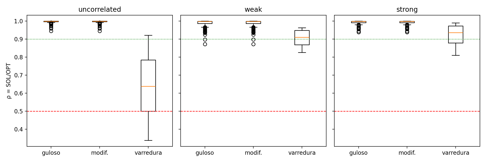
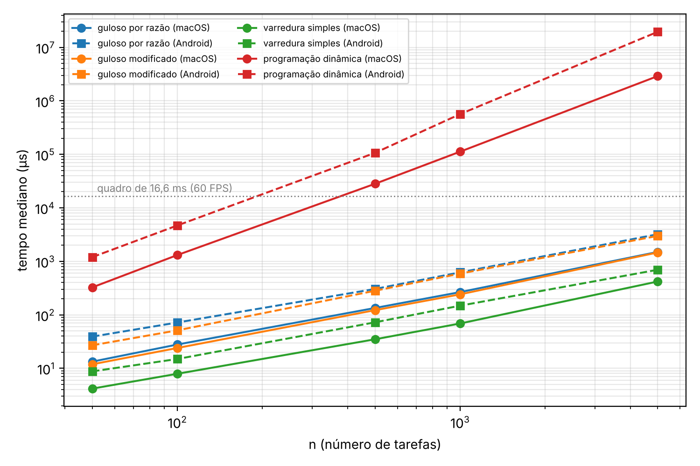
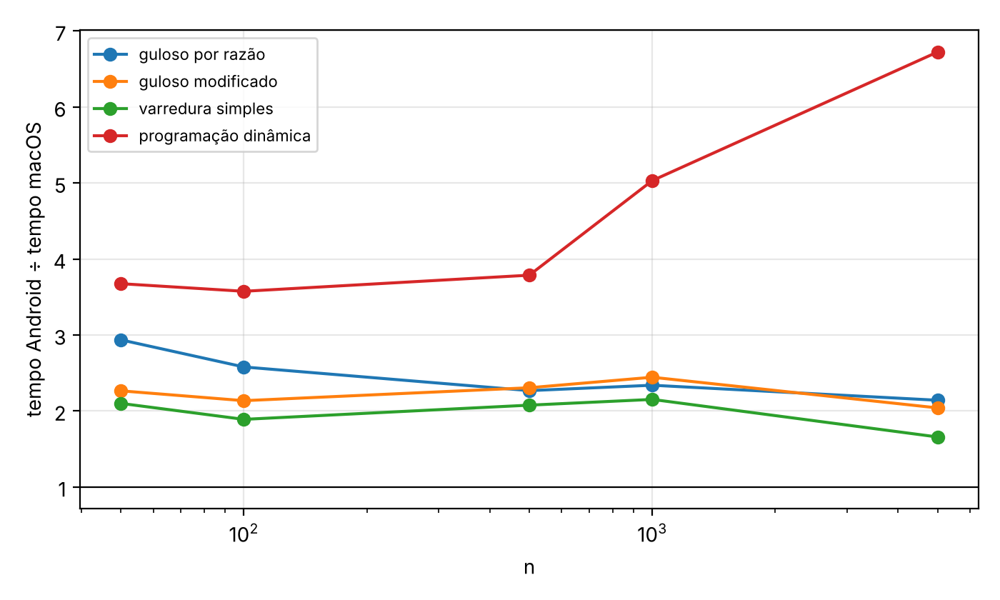

# Alocação gulosa de orçamento de quadro entre Android e desktop sob kernel compartilhado: análise de aproximação

**Felipe de Freitas da Silva**  
Centro Universitário do Pará (CESUPA) – Belém, PA – Brazil  
`felipe24070063@aluno.cesupa.br`

---

**Abstract.** ARM64 mobile devices can run Android and a Linux desktop at the same time on a shared kernel, but this requires splitting a limited per-frame CPU and GPU budget between the two environments. This work models that split as a 0-1 knapsack problem: the mobile environment reserves its share with absolute priority, and the desktop receives the remainder, filled with the tasks of highest total importance. Since the problem is NP-hard, we analyze a greedy algorithm based on the importance-to-cost ratio, adjusted by the largest single item, which guarantees at least half of the optimal value, and compare it with exact dynamic programming. On 450 synthetic instances, run on macOS (Apple A18 Pro) and on Android (Snapdragon 6 Gen 1), the greedy algorithm averaged 0.99 of the optimum, with a minimum of 0.87, and fit in the 16.6 ms frame with 5000 tasks: 1.5 ms on macOS and 3.0 ms on Android. Dynamic programming exceeded the frame from 500 tasks on and was 3.6 to 6.7 times slower on Android. Measured times followed the theoretical curves.

**Resumo.** Dispositivos móveis ARM64 podem executar Android e desktop Linux ao mesmo tempo sobre o mesmo kernel, mas isso exige dividir, a cada quadro, um orçamento limitado de CPU e GPU entre os dois ambientes. Este trabalho modela essa divisão como um problema da mochila 0-1: o ambiente móvel reserva sua parcela com prioridade absoluta, e o desktop recebe a sobra, preenchida com as tarefas de maior importância total. Como o problema é NP-difícil, analisa-se um algoritmo guloso por razão importância/custo, com ajuste pelo maior item, que garante pelo menos metade do valor ótimo, e compara-se à programação dinâmica exata. Em 450 instâncias sintéticas, executadas em macOS (Apple A18 Pro) e em Android (Snapdragon 6 Gen 1), o guloso ficou em média a 0,99 do ótimo, com mínimo de 0,87, e coube no quadro de 16,6 ms com 5000 tarefas: 1,5 ms no macOS e 3,0 ms no Android. A programação dinâmica passou do quadro a partir de 500 tarefas e foi de 3,6 a 6,7 vezes mais lenta no Android. Os tempos medidos seguiram as curvas teóricas.

---

## 1. Introdução

### 1.1 Contextualização
Smartphones, dobráveis e tablets modernos usam chips ARM64 com desempenho comparável ao de notebooks, mas seus sistemas operacionais limitam o uso como estação de trabalho. O projeto ARMOS propõe uma arquitetura de referência em que o mesmo kernel Linux executa, ao mesmo tempo, contêineres móveis (`.apk`) e de desktop (`.deb`). Nessa arquitetura, os dois ambientes disputam CPU e GPU. A interface móvel e as chamadas telefônicas precisam ter prioridade absoluta, e o desktop só pode usar o que sobrar. Quem sofre com uma divisão ruim é o usuário: se o desktop consome demais, o celular trava; se consome menos, o hardware fica ocioso.

### 1.2 Formulação do problema
A cada quadro, o sistema dispõe de um orçamento de tempo $B$ (por exemplo, cerca de $16,6\text{ ms}$ a 60 quadros por segundo). O ambiente Android reserva uma parcela $R$, e a sobra é $C = B - R$.

Dado um conjunto $N = \{1, 2, \dots, n\}$ de $n$ tarefas concorrentes do ambiente desktop, onde cada tarefa $i \in N$ possui um custo estimado $c_i \in \mathbb{Z}^+$ (tempo de processamento) e um ganho/importância $p_i \in \mathbb{Z}^+$, deseja-se encontrar um vetor de decisão $x = (x_1, x_2, \dots, x_n) \in \{0, 1\}^n$ que resolva o seguinte problema de otimização combinatória:

$$\max \sum_{i=1}^{n} p_i x_i \quad \text{sujeito a} \quad \sum_{i=1}^{n} c_i x_i \leq C$$

O Problema da Mochila 0-1 é classificado como NP-difícil (*NP-hard*). Consequentemente, não se conhece um algoritmo exato de tempo polinomial $O(n^k)$ para resolvê-lo no pior caso, a menos que $\text{P} = \text{NP}$. Em um ambiente de processamento de quadros em tempo real, calcular a solução ótima exata via programação dinâmica — cujo tempo de execução é pseudo-polinomial $O(n \cdot C)$ — torna-se impraticável quando $C$ é elevado (Chen et al., 2024; Feng, 2026) ou quando a frequência de quadros exige latência de decisão na escala de sub-milissegundos (Fernando e Ballera, 2025; Nigade et al., 2024).

### 1.3 Objetivo geral
Este trabalho investiga a viabilidade prática e teórica do emprego de algoritmos aproximativos e gulosos para o problema da alocação de orçamento em tempo real. Especificamente, os objetivos do estudo são:

* **Análise Teórica:** Analisar o algoritmo guloso baseado na razão ganho/custo ($p_i / c_i$) modificado pela regra do maior item isolado, demonstrando sua garantia formal de aproximação de fator $1/2$ (isto é, 2-aproximativo) com complexidade temporal de ordenação $O(n \log n)$.
* **Comparação Experimental:** Confrontar o algoritmo guloso com a solução ótima exata (via Programação Dinâmica) e com algoritmos de varredura simples em um conjunto de instâncias sintéticas que simulam diferentes perfis de carga gráfica.
* **Avaliação da Razão Empírica:** Avaliar se a qualidade da solução empírica do algoritmo guloso aproxima-se do ótimo na prática ($>90\%$), justificando seu uso em gerenciadores de composição de interface em sistemas operacionais híbridos.

### 1.4 Objetivos específicos
* Formalizar o problema e demonstrar sua NP-dificuldade.
* Analisar a complexidade de tempo e espaço do guloso modificado e da programação dinâmica, e demonstrar a garantia de aproximação de $1/2$.
* Comparar experimentalmente o guloso, a programação dinâmica exata e uma varredura simples na ordem de chegada, em instâncias sintéticas.
* Testar a hipótese de que a razão de aproximação empírica supera $0,9$ na maioria das instâncias.

### 1.5 Justificativa
A decisão precisa ocorrer a cada quadro, então o algoritmo deve ser muito rápido. A solução exata por programação dinâmica tem custo proporcional à capacidade $C$ e pode ser cara demais; o guloso é rápido, mas é preciso saber quanto se perde em qualidade. A literatura de esquemas de aproximação para a mochila avança no tempo assintótico (Ibarra e Kim, 1975; Deng et al., 2023; Mao, 2024), mas, entre os trabalhos consultados até aqui, nenhum trata da decisão por quadro com reserva de prioridade para o ambiente móvel nem mede quanto um guloso simples perde nesse tipo de carga.

### 1.6 Organização do texto
A Seção 2 apresenta a fundamentação teórica e os trabalhos relacionados, com a NP-dificuldade do problema, as propriedades do guloso aproximativo e o estado da arte. A Seção 3 descreve a metodologia: o modelo experimental, os geradores de instâncias e as métricas. A Seção 4 apresenta os resultados e a discussão, e a Seção 5, as conclusões.

---

## 2. Fundamentação Teórica e Trabalhos Relacionados

### 2.1 Notação assintótica
A notação assintótica segue a convenção de Cormen et al. (2009). Dadas funções $f$ e $g$ de $n$, escreve-se $f(n) = O(g(n))$ se existem constantes $c > 0$ e $n_0$ tais que $0 \leq f(n) \leq c \cdot g(n)$ para todo $n \geq n_0$ (limite superior). Escreve-se $f(n) = \Omega(g(n))$ se $0 \leq c \cdot g(n) \leq f(n)$ para todo $n \geq n_0$ (limite inferior), e $f(n) = \Theta(g(n))$ quando as duas condições valem (limite justo). A notação $\tilde{O}(g(n))$ esconde fatores logarítmicos e aparece nos resultados de aproximação citados na Seção 2.5.

### 2.2 Problema da mochila e NP-dificuldade
O problema da mochila 0-1 consta na lista original de 21 problemas de Karp (Karp, 1972).

**Teorema 1.** *O problema da mochila 0-1 é NP-difícil.*

**Demonstração.** Considera-se a versão de decisão: dados $c_i$, $p_i$, $C$ e uma meta $K$, existe $x \in \{0, 1\}^n$ com $\sum c_i x_i \leq C$ e $\sum p_i x_i \geq K$? Ela está em NP, pois, dado $x$, as duas somas se verificam em tempo polinomial. Para a dificuldade, reduz-se o *Subset Sum*, que é NP-completo (Cormen et al., 2009): dado um conjunto de inteiros positivos $S = \{s_1, \dots, s_n\}$ e um alvo $t \in \mathbb{Z}^+$, existe $S' \subseteq S$ cuja soma é exatamente $t$? Constrói-se a instância da mochila com $c_i = p_i = s_i$ para cada $i$, $C = t$ e $K = t$. A construção leva tempo $O(n)$. Como custo e importância coincidem, um vetor $x$ que satisfaz $\sum c_i x_i \leq t$ e $\sum p_i x_i \geq t$ tem soma exatamente $t$; reciprocamente, um subconjunto de soma $t$ fornece um $x$ viável. Logo a instância da mochila tem resposta “sim” se e somente se a de *Subset Sum* tem. $\blacksquare$

### 2.3 Programação dinâmica exata
O Problema da Mochila 0-1 pode ser resolvido de forma exata utilizando Programação Dinâmica. A formulação clássica preenche uma tabela de subproblemas em tempo pseudo-polinomial de $O(n \cdot C)$, onde $n$ é o número de tarefas e $C$ representa o orçamento total de capacidade (tempo de processamento disponível).

No que tange aos requisitos de memória (espaço):

* **Apenas o Valor Ótimo:** Se o objetivo restringe-se exclusivamente a determinar o ganho máximo obtido, a complexidade espacial pode ser otimizada para $O(C)$ mediante a compactação da tabela de estados em um vetor unidimensional de capacidade.
* **Recuperação do Conjunto de Itens:** Para reconstruir a combinação exata de tarefas selecionadas na solução ótima, é necessário manter o histórico completo das decisões ou a matriz bidimensional de estados, o que eleva a complexidade espacial para $O(n \cdot C)$.

Ademais, destaca-se que a complexidade de tempo é pseudo-polinomial, visto que seu crescimento é proporcional ao valor numérico de $C$ (o orçamento expresso em unidades discretas, como microssegundos ou ciclos de clock) e não ao tamanho da entrada medido em número de bits ($\log C$). Consequentemente, em instâncias densas ou com grandes horizontes de orçamento, essa abordagem exata torna-se computacionalmente custosa e inviável para operação estrita em tempo real, justificando o emprego de heurísticas gulosas de menor complexidade.

### 2.4 Algoritmo guloso e garantia de aproximação
Dado que a busca pelo ótimo global exato é computacionalmente proibitiva em tempo real, emprega-se uma estratégia baseada em algoritmos aproximativos.

O Algoritmo Guloso por Razão (*Density Greedy Algorithm*) ordena os itens em ordem decrescente de eficiência/densidade, dada pela razão ganho-custo (itens com $c_i > C$ são descartados antes, pois não cabem em nenhuma solução):

$$\frac{p_1}{c_1} \geq \frac{p_2}{c_2} \geq \dots \geq \frac{p_n}{c_n}$$

O algoritmo insere os itens nessa ordem na mochila até que o próximo item exceda o orçamento restante. Seja $k$ o primeiro item que não coube na mochila (denotado como item de quebra ou *break item*). Se todos os itens couberem, a solução gulosa já é ótima e não há item de quebra.

Uma estratégia puramente gulosa pode ter um desempenho arbitrariamente ruim no pior caso. Por exemplo, se $C = 100$, com item 1 possuindo $c_1 = 1, p_1 = 2$ (razão 2) e item 2 com $c_2 = 100, p_2 = 100$ (razão 1), o guloso tradicional escolhe apenas o item 1 (ganho 2), enquanto o ótimo seria o item 2 (ganho 100).

Para garantir um limite inferior formal, utiliza-se o Algoritmo Guloso Modificado (ou *Modified Greedy*), que compara duas soluções candidatas:

1. A solução obtida pela seleção gulosa sequencial: $\text{SOL}_{\text{gulosa}} = \sum_{i=1}^{k-1} p_i$.
2. O ganho do maior item isolado que cabe na mochila: $p_{\max} = \max\{ p_i : c_i \leq C \}$.

A solução final devolvida pelo algoritmo é:

$$\text{SOL} = \max\left( \sum_{i=1}^{k-1} p_i ,\; \max\{ p_i : c_i \leq C \} \right)$$

**Teorema 2.** *O Algoritmo Guloso Modificado para o Problema da Mochila 0-1 é uma $1/2$-aproximação (isto é, um algoritmo 2-aproximativo), garantindo $\text{SOL} \geq \frac{1}{2} \cdot \text{OPT}$.*

**Demonstração.** Considere a relaxação fracionária do problema da mochila (onde é permitido selecionar frações $x_i \in [0, 1]$ dos itens). A solução ótima fracionária $\text{OPT}_{\text{frac}}$ constitui um limite superior para a solução ótima inteira $\text{OPT}$ (Williamson e Shmoys, 2011):

$$\text{OPT} \leq \text{OPT}_{\text{frac}} = \sum_{i=1}^{k-1} p_i + \bar{x}_k \cdot p_k$$

Onde $\bar{x}_k = \left(C - \sum_{i=1}^{k-1} c_i\right)/c_k < 1$ representa a fração do item de quebra $k$ que preenche o espaço restante. Como $\bar{x}_k < 1$, temos:

$$\text{OPT} \leq \sum_{i=1}^{k-1} p_i + p_k$$

Como $c_k \leq C$ (os itens com $c_i > C$ foram descartados), vale $p_k \leq p_{\max}$. Aplicando a definição da nossa solução $\text{SOL} = \max\left(\sum_{i=1}^{k-1} p_i, p_{\max}\right)$, sabemos que $\text{SOL} \geq \sum_{i=1}^{k-1} p_i$ e $\text{SOL} \geq p_{\max}$. Somando ambas as desigualdades:

$$2 \cdot \text{SOL} \geq \sum_{i=1}^{k-1} p_i + p_{\max} \geq \sum_{i=1}^{k-1} p_i + p_k \geq \text{OPT}$$

ou seja, $\text{SOL} \geq \frac{1}{2} \cdot \text{OPT}$. $\blacksquare$

A complexidade de tempo do algoritmo é dominada pela etapa de ordenação dos $n$ itens, resultando em $O(n \log n)$ de tempo e $O(1)$ de espaço auxiliar além da estrutura dos dados.

### 2.5 Esquemas de aproximação (FPTAS)
Um esquema de aproximação totalmente polinomial (FPTAS) devolve, para qualquer $\varepsilon > 0$, uma solução de valor pelo menos $(1 - \varepsilon)$ do ótimo, em tempo polinomial em $n$ e $1/\varepsilon$. O FPTAS de Ibarra e Kim (1975) é o ponto de partida dessa linha para a mochila. O melhor algoritmo anterior a Mao (2024) era randomizado e rodava em $\tilde{O}(n + (1/\varepsilon)^{2,2})$ (Deng et al., 2023). Mao (2024) apresentou um esquema determinístico em $\tilde{O}(n + (1/\varepsilon)^2)$, que coincide com o limite inferior condicional de $(n + 1/\varepsilon)^{2-o(1)}$, baseado na hipótese da convolução $(\min,+)$ (Deng et al., 2023). Jin (2024) também trata a mochila 0-1 em tempo quase quadrático.

### 2.6 Alocação de recursos em escalonamento
Os sistemas operacionais modernos gerenciam a CPU equilibrando prioridades e justiça por meio de escalonadores como o CFS (*Completely Fair Scheduler*) no Linux, que atribui fatias de tempo proporcionais baseadas em pesos dinâmicos de prioridade (*nice*), além de contar com classes estritas de tempo real para tarefas críticas (Tanenbaum e Bos, 2016). Contudo, como o cálculo do escalonamento perfeitamente ótimo é computacionalmente intratável no pior caso, os kernels evitam abordagens exatas de alto custo em favor de heurísticas rápidas.

Do ponto de vista teórico, os limites de pior caso variam conforme o modelo de escalonamento. Em sistemas de tempo real rígido, o limite clássico do *Rate Monotonic Scheduling* (RMS) garante a ausência de perda de prazos até uma utilização total de aproximadamente $69,3\%$ da CPU ($n \to \infty$), enquanto o *Earliest Deadline First* (EDF) atinge a otimalidade com $100\%$ de utilização em uniprocessadores (Tanenbaum e Bos, 2016). Já em cenários de otimização combinatória e alocação sob restrições de orçamento — paralelos ao problema de alocação de quadros abordado neste trabalho —, regras clássicas como o algoritmo LPT (*Longest Processing Time first*) analisado por Graham (1966) estabelecem limites rígidos de aproximação para o *makespan* ($2 - 1/m$), enquanto abordagens gulosas baseadas em densidade para problemas de mochila garantem limites seguros de $1/2$ (Williamson e Shmoys, 2011). Essa fundamentação permite que o sistema operacional tome decisões em microssegundos, garantindo previsibilidade temporal e evitando que o *jitter* viole a janela estrita de renderização gráfica.

### 2.7 Discussão e lacuna
A literatura teórica sobre o Problema da Mochila avançou significativamente no desenvolvimento de Esquemas de Aproximação em Tempo Polinomial (PTAS e FPTAS). Ibarra e Kim (1975) introduziram o primeiro FPTAS com complexidade $O(n \log n + (1/\varepsilon)^4)$, posteriormente aprimorado por Lawler (1979). Recentemente, Deng, Jin e Mao (2023) e Mao (2024) estabelecem novos limites teóricos para a mochila 0-1, alcançando algoritmos determinísticos de $(1-\varepsilon)$-aproximação em tempo quase-quadrático $\tilde{O}(n + (1/\varepsilon)^2)$, aproximando-se do limite inferior condicional baseado na hipótese $(\min,+)$-convolução.

**Tabela 1 – Comparação assintótica das principais abordagens para o Problema da Mochila 0-1.**

| Abordagem | Tempo | Garantia | Fonte |
| :--- | :--- | :--- | :--- |
| Programação dinâmica exata | $O(n \cdot C)$ | Ótimo | Cormen et al. (2009); Williamson e Shmoys (2011) |
| Guloso por razão, com ajuste pelo maior item | $O(n \log n)$ | $1/2$ do ótimo | Teorema 2 (Seção 2.4) |
| FPTAS de Ibarra e Kim | $O(n \log n + (1/\varepsilon)^4 \log(1/\varepsilon))$ | $(1 - \varepsilon)$ | Ibarra e Kim (1975) |
| Melhor FPTAS randomizado anterior a Mao | $\tilde{O}(n + (1/\varepsilon)^{2,2})$ | $(1 - \varepsilon)$ | Deng et al. (2023) |
| FPTAS determinístico recente | $\tilde{O}(n + (1/\varepsilon)^2)$ | $(1 - \varepsilon)$ | Mao (2024) |

**Lacuna da Literatura:** Apesar do elevado refinamento teórico desses esquemas avançados ($(1-\varepsilon)$-aproximação), eles impõem constantes ocultas substanciais e sobrecarga de gerenciamento de memória que inviabilizam sua execução contínua em laços de renderização de alta frequência ($60\text{ Hz}$ ou $120\text{ Hz}$). A literatura existente foca prioritariamente na redução teórica do expoente de $\varepsilon$ para instâncias genéricas de grande porte, enquanto a alocação de orçamento de quadros sob um kernel compartilhado ARM64 exige decisões determinísticas e com variação temporal (*jitter*) mínima em sub-milissegundos. Este artigo preenche essa lacuna ao avaliar formal e empiricamente se a heurística gulosa de $O(n \log n)$ oferece um *trade-off* superior entre qualidade empírica ($>90\%$ do ótimo) e previsibilidade de latência para ambientes operacionais híbridos Android/Desktop.

---

## 3. Metodologia

Para avaliar o desempenho e a viabilidade prática do algoritmo guloso modificado em comparação com a solução ótima (obtida por Programação Dinâmica), estruturou-se uma metodologia experimental baseada em simulação controlada de divisão de cargas de trabalho em ambiente híbrido Android-Desktop.

### 3.1 Ambiente de execução e ferramentas
* **Implementação:** Python 3 (as versões de cada ambiente estão na Seção 4), com `time.perf_counter` para medir o tempo, `numpy` para a programação dinâmica vetorizada, `scipy` para o ajuste de curvas e `matplotlib` para os gráficos. Os algoritmos são: guloso por razão, guloso modificado, programação dinâmica exata (referência para o ótimo) e uma varredura simples na ordem de chegada (linha de base).
* **Ambiente de execução:** MacBook Neo com chip Apple A18 Pro (ARM64), 6 núcleos, 8 GB de RAM, macOS 27.2.1 e Python 3.9.6 (`numpy` 2.0.2). O ambiente Android é descrito na Seção 4. O dispositivo foi reiniciado para ficar sem memória cache e outras aplicações, e consequentemente sem interferência de outros processos nos testes realizados.
* **Limite da simulação:** o processador é ARM64, mas os experimentos rodam sobre o macOS, e não sobre o kernel Linux compartilhado do ARMOS. Por isso o experimento simula a divisão do orçamento.
* **Tamanhos e repetições:** $n \in \{50, 100, 500, 1000, 5000\}$, com no mínimo 10 repetições por configuração.
* **Confronto teoria $\times$ prática:** ajustar a curva do tempo medido ao modelo $O(n \log n)$ para o guloso e $O(n \cdot C)$ para a programação dinâmica, e verificar que a razão de aproximação observada nunca fica abaixo de $1/2$.

### 3.2 Geração de instâncias sintéticas
O gerador de instâncias sintéticas baseia-se nas categorias clássicas consolidadas por Martello e Toth (1990), estruturando-se em três perfis de correlação entre custo ($c_i$) e importância ($p_i$):

* **Não correlacionadas:** onde custos $c_i$ e importâncias $p_i$ são gerados de forma independente e uniforme em $[1, W_{\max}]$.
* **Fracamente correlacionadas:** onde os custos são uniformes em $[1, W_{\max}]$ e as importâncias flutuam em torno de um intervalo restrito baseado no custo ($[c_i - R/10, c_i + R/10]$), com limite inferior $1$.
* **Fortemente correlacionadas:** onde a importância é diretamente proporcional ao custo acrescido de uma constante fixa ($p_i = c_i + R/10$).

O número de tarefas $n$ varia nos patamares da Seção 3.1, e a capacidade é $C = \lfloor \gamma \cdot \sum c_i \rfloor$, com $\gamma \in \{0,25;\; 0,5;\; 0,75\}$, para testar diferentes níveis de saturação do orçamento. A semente do gerador é fixa e registrada.

### 3.3 Métricas de avaliação
* **Razão de aproximação empírica:** $\rho = \text{SOL}/\text{OPT}$, com $\text{OPT}$ obtido pela programação dinâmica. A garantia teórica é $\rho \geq 1/2$. A hipótese a testar é que $\rho \geq 0,9$ na maioria das instâncias.
* **Tempo de execução:** em microssegundos, comparado ao limite de $16,6\text{ ms}$ do quadro a $60\text{ FPS}$.
* **Estabilidade (*jitter*):** desvio padrão do tempo em múltiplas execuções, além dos percentis 95 e 99 e do máximo.
* **Complementares:** número de operações elementares e uso de memória.

---

## 4. Resultados e Discussão

Os experimentos seguiram a Seção 3: $n \in \{50, 100, 500, 1000, 5000\}$, $\gamma \in \{0,25;\; 0,5;\; 0,75\}$, três tipos de instância, 10 repetições por configuração, $R = 1000$ e semente 42, o que dá 450 instâncias por ambiente. O mesmo código foi executado em dois ambientes: (i) macOS 27.2.1, em um MacBook Neo com chip Apple A18 Pro (ARM64, 6 núcleos, 8 GB), com Python 3.9.6 e `numpy` 2.0.2; e (ii) Android 16, em um aparelho Moto Edge 50 Fusion com Snapdragon 6 Gen 1 (8 núcleos, 7,3 GB), executando Debian em PRoot dentro do Termux, kernel Linux 6.17.0, com Python 3.12.15 e `numpy` 2.5.5. O código e os dados estão em `https://github.com/ffelipef/armos-knapsack/`. Os valores de custo, capacidade e solução de todos os algoritmos foram idênticos nas 450 instâncias dos dois ambientes. Portanto, a razão de aproximação é a mesma, e apenas o tempo difere.

### 4.1 Resultados no macOS

**Tabela 2 – Tempo mediano no macOS (ms).**

| $n$ | Guloso por razão | Guloso modificado | Varredura simples | Programação dinâmica |
| :--- | :---: | :---: | :---: | :---: |
| 50 | 0,013 | 0,012 | 0,004 | 0,33 |
| 100 | 0,028 | 0,024 | 0,008 | 1,31 |
| 500 | 0,134 | 0,122 | 0,035 | 28,13 |
| 1000 | 0,266 | 0,241 | 0,069 | 112,20 |
| 5000 | 1,50 | 1,46 | 0,42 | 2.903,11 |

O guloso modificado levou $1,46\text{ ms}$ com $n = 5000$, cerca de $8,8\%$ do quadro de $16,6\text{ ms}$. A programação dinâmica levou $1,31\text{ ms}$ com $n = 100$, $28,13\text{ ms}$ com $n = 500$ (acima do quadro em $71\%$ das execuções) e $2,9\text{ s}$ com $n = 5000$, de $1,4\text{ s}$ a $4,5\text{ s}$ conforme $\gamma$ vai de $0,25$ a $0,75$. O pico de memória com $n = 5000$ foi de $19,0\text{ MiB}$ na programação dinâmica e $0,35\text{ MiB}$ no guloso modificado. Os expoentes empíricos (regressão log-log da mediana) foram $1,02$ para o guloso por razão, $1,04$ para o guloso modificado, $0,99$ para a varredura e $1,97$ para a programação dinâmica. O ajuste ao modelo $a \cdot n \cdot \log_2 n + b$ teve $R^2 = 1,000$ para os dois gulosos, e o ajuste $a \cdot n \cdot C + b$ da programação dinâmica teve $R^2 = 0,996$.

No guloso modificado com $n = 5000$, o percentil 95 do tempo foi $2,0\text{ ms}$, o percentil 99, $5,8\text{ ms}$, e o máximo, $32,9\text{ ms}$. Essa execução foi a única, entre as 450 do macOS, a superar o quadro de $16,6\text{ ms}$.

**Tabela 3 – Razão de aproximação $\rho = \text{SOL}/\text{OPT}$ (igual nos dois ambientes).**

| Tipo de instância | Algoritmo | $\rho$ médio | $\rho$ mínimo | Instâncias com $\rho \geq 0,9$ |
| :--- | :--- | :---: | :---: | :---: |
| Não correlacionadas | Guloso (por razão e modificado) | 0,9958 | 0,9451 | 100,0% |
| Não correlacionadas | Varredura simples | 0,6395 | 0,3379 | 0,7% |
| Fracamente correlacionadas | Guloso (por razão e modificado) | 0,9880 | 0,8721 | 98,7% |
| Fracamente correlacionadas | Varredura simples | 0,9071 | 0,8257 | 65,3% |
| Fortemente correlacionadas | Guloso (por razão e modificado) | 0,9929 | 0,9384 | 100,0% |
| Fortemente correlacionadas | Varredura simples | 0,9289 | 0,8097 | 70,0% |

O guloso modificado teve $\rho$ médio entre $0,988$ e $0,996$, com mínimo de $0,872$ (instâncias fracamente correlacionadas, $\gamma = 0,25$, $n = 50$). Apenas 2 das 450 instâncias ($0,4\%$) ficaram abaixo de $0,9$, ambas com $n = 50$ e correlação fraca, o que confirma a hipótese de $\rho \geq 0,9$ na maioria das instâncias. Nenhuma instância violou a garantia de $1/2$. O $\rho$ mínimo cresce com $n$: nas instâncias fracamente correlacionadas, foi de $0,872$ com $n = 50$ a $0,9989$ com $n = 5000$. O guloso modificado e o guloso por razão produziram o mesmo valor nas 450 instâncias. A varredura simples teve $\rho$ mínimo de $0,34$, e só $0,7\%$ das instâncias não correlacionadas chegaram a $0,9$.

> **[Figura 1]:** *Distribuição de $\rho$ por tipo de instância e algoritmo.*

### 4.2 Resultados no Android

**Tabela 4 – Tempo mediano no Android (ms).**

| $n$ | Guloso por razão | Guloso modificado | Varredura simples | Programação dinâmica |
| :--- | :---: | :---: | :---: | :---: |
| 50 | 0,039 | 0,027 | 0,009 | 1,20 |
| 100 | 0,072 | 0,051 | 0,015 | 4,69 |
| 500 | 0,304 | 0,281 | 0,072 | 106,53 |
| 1000 | 0,621 | 0,589 | 0,148 | 564,58 |
| 5000 | 3,21 | 2,99 | 0,69 | 19.524,63 |

O guloso modificado levou $2,99\text{ ms}$ com $n = 5000$, cerca de $18\%$ do quadro. O percentil 95 foi $5,5\text{ ms}$, o percentil 99, $5,9\text{ ms}$, e o máximo, $7,9\text{ ms}$, e nenhuma das 450 execuções superou $16,6\text{ ms}$. A programação dinâmica levou $4,69\text{ ms}$ com $n = 100$ ($28\%$ do quadro), $106,5\text{ ms}$ com $n = 500$ (acima do quadro em todas as execuções) e $19,5\text{ s}$ com $n = 5000$, de $9,1\text{ s}$ a $28,3\text{ s}$ conforme $\gamma$. O pico de memória com $n = 5000$ foi de $19,0\text{ MiB}$ na programação dinâmica e $0,37\text{ MiB}$ no guloso modificado. Os expoentes empíricos foram $0,95$ (guloso por razão), $1,03$ (guloso modificado), $0,96$ (varredura) e $2,10$ (programação dinâmica). Os ajustes tiveram $R^2 = 0,999$ para os gulosos, $1,000$ para a varredura e $0,990$ para a programação dinâmica. A razão de aproximação é a da Tabela 3.

### 4.3 Comparação entre os ambientes

**Tabela 5 – Razão entre os tempos medianos ($\text{Android} \div \text{macOS}$).**

| $n$ | Guloso por razão | Guloso modificado | Varredura simples | Programação dinâmica |
| :--- | :---: | :---: | :---: | :---: |
| 50 | 2,94 | 2,27 | 2,10 | 3,68 |
| 100 | 2,58 | 2,14 | 1,89 | 3,58 |
| 500 | 2,27 | 2,31 | 2,08 | 3,79 |
| 1000 | 2,34 | 2,44 | 2,15 | 5,03 |
| 5000 | 2,14 | 2,04 | 1,66 | 6,73 |

O Android foi de $1,7$ a $2,9$ vezes mais lento nos gulosos e na varredura, e de $3,6$ a $6,7$ vezes mais lento na programação dinâmica, com a razão crescendo com $n$. Com $n = 5000$, a programação dinâmica foi $1.984$ vezes mais lenta que o guloso modificado no macOS e $6.538$ vezes no Android, ou seja, a vantagem do guloso é maior no aparelho móvel. Nos dois ambientes, o guloso coube no quadro em todos os tamanhos, e a programação dinâmica passou do quadro entre $n = 100$ e $n = 500$. O macOS foi mais rápido em todas as células da Tabela 5, mesmo com a versão mais antiga do Python (3.9.6, contra 3.12.15 no Android). Isso vale para as duas configurações completas (chip, sistema, Python e `numpy`), e não só para o hardware.

> **[Figura 2]:** *Tempo mediano por $n$ nos dois ambientes, em escala log-log.*

> **[Figura 3]:** *Razão entre os tempos no Android e no macOS, por algoritmo.*

### 4.4 Divergências em relação à previsão assintótica
* **Guloso:** os expoentes ($1,02$ a $1,04$ no macOS e $0,95$ a $1,03$ no Android) ficaram abaixo do esperado para $n \log n$ nessa faixa. Entre $n = 50$ e $n = 5000$, o fator $\log_2 n$ varia de $5,6$ a $12,3$, e um $n \log n$ puro daria um expoente efetivo próximo de $1,17$. Isso sugere que o custo dominante são as passagens lineares em Python (filtro, cálculo da razão e varredura), e que a ordenação, feita em C, pesa pouco. É uma hipótese, que não foi testada isoladamente.
* **Programação dinâmica:** o expoente foi $1,97$ no macOS, perto do $2$ previsto ($n \cdot C$ com $C$ proporcional a $n$), e $2,10$ no Android. Como a razão Android/macOS cresce com $n$ e a tabela chega a cerca de $19\text{ MiB}$, uma hipótese é o efeito da hierarquia de memória, que não foi medido diretamente. Os ajustes lineares tiveram intercepto negativo ($-9,7\text{ ms}$ no macOS e $-30,2\text{ ms}$ no Android), porque o ajuste mistura valores de $\gamma$ e o modelo $a \cdot n \cdot C + b$ não captura essa estrutura. O intercepto não tem interpretação física.
* **Garantia de $1/2$:** em instâncias aleatórias, ela é muito folgada: o pior $\rho$ foi $0,872$. Como o guloso modificado e o guloso por razão deram o mesmo valor em todas as instâncias, os experimentos não exercitaram a regra do maior item, que só importa em casos como o contraexemplo da Seção 2.4. Os resultados confirmam a qualidade média, mas não testam o pior caso.
* **Variação do tempo (*jitter*):** no macOS, uma execução isolada chegou a $32,9\text{ ms}$ ($22$ vezes a mediana), enquanto o máximo no Android foi $7,9\text{ ms}$ ($2,6$ vezes a mediana). Já o percentil 95 relativo à mediana foi maior no Android ($1,8\times$) que no macOS ($1,4\times$). Com uma execução cronometrada por instância e sem controle da interferência do sistema, não é possível concluir que um ambiente seja mais estável.
* **Premissa de tempo real:** a programação dinâmica ainda cabe no quadro com $n \leq 100$ nos dois ambientes ($1,3\text{ ms}$ no macOS e $4,7\text{ ms}$ no Android). A afirmação da Seção 1.2, de que a solução exata é impraticável, vale para $n \gtrsim 500$ nos parâmetros testados. O custo da programação dinâmica também cresce com $C$, e portanto com a resolução adotada para o orçamento ($R$).

### 4.5 Limitações
* Um aparelho por plataforma, e uma execução cronometrada por instância.
* Versões diferentes: macOS com Python 3.9.6 e `numpy` 2.0.2, Android com Python 3.12.15 e `numpy` 2.5.5. A diferença de tempo não é só do hardware, e o efeito das versões não foi isolado. Como o CPython 3.11 e posteriores costumam ser mais rápidos que o 3.9 em laços Python puros (`https://docs.python.org/pt-br/dev/whatsnew/3.11.html`), a versão mais antiga do macOS tenderia a desfavorecê-lo, e ainda assim ele foi mais rápido. O `numpy` também difere, e esse efeito não foi avaliado.
* O Android executou Debian em PRoot dentro do Termux, e não um Linux nativo. As chamadas ao kernel passam pelo PRoot.
* Sem controle de temperatura, de frequência do processador nem de afinidade de núcleos.
* Instâncias sintéticas: $R = 1000$ define a resolução do orçamento, e $n = 5000$ tarefas por quadro é maior que o esperado em um desktop real.
* Os experimentos não rodam no kernel compartilhado do ARMOS e não medem o compositor gráfico.

---

## 5. Conclusão

Este trabalho modelou a divisão do orçamento de quadro entre Android e desktop como uma mochila 0-1, demonstrou que ela é NP-difícil e analisou um guloso modificado de $O(n \log n)$ com garantia de $1/2$. Em 450 instâncias sintéticas, executadas em macOS (Apple A18 Pro) e em Android (Snapdragon 6 Gen 1), o guloso obteve $\rho$ médio de $0,99$ (mínimo $0,87$), com $99,6\%$ das instâncias acima de $0,9$, e coube no quadro de $16,6\text{ ms}$ com 5000 tarefas: $1,5\text{ ms}$ no macOS e $3,0\text{ ms}$ no Android. A programação dinâmica exata, de custo $O(n \cdot C)$, passou do quadro a partir de 500 tarefas e levou $19,5\text{ s}$ no Android com 5000 tarefas. Os tempos confirmaram as previsões assintóticas, com expoentes de $0,95$ a $1,04$ para os gulosos e de $1,97$ e $2,10$ para a programação dinâmica, e as divergências foram discutidas na Seção 4.4.

Os resultados indicam que, nesse cenário, o guloso modificado é uma escolha prática: perde pouco em qualidade e tem tempo previsível. Com poucas tarefas, a programação dinâmica ainda é viável. As limitações da Seção 4.5 impedem generalizar os resultados para o kernel compartilhado do ARMOS.

Como trabalhos futuros: (i) validar no kernel compartilhado do ARMOS, com o compositor real; (ii) incluir famílias adversariais, que exercitem a regra do maior item; (iii) implementar e medir um esquema de aproximação, como o de Ibarra e Kim, como ponto intermediário; (iv) isolar o efeito da hierarquia de memória e repetir os experimentos com a mesma versão de Python, controle de temperatura e mais aparelhos.

---

## Declaração de uso de ferramentas de IA
Foi usada uma ferramenta de IA generativa (Claude) para estruturar o rascunho do artigo, sugerir a modelagem do problema, localizar candidatas a referências e apoiar a revisão do texto. As referências foram lidas e conferidas pelo autor.

---

## Referências

* **CHEN, L.; LIAN, J.; MAO, Y.; ZHANG, G.** Faster algorithms for bounded knapsack and bounded subset sum via fine-grained proximity results. In: *Proceedings of the 2024 Annual ACM-SIAM Symposium on Discrete Algorithms (SODA)*, p. 4778–4811. SIAM, 2024.
* **CORMEN, T. H.; LEISERSON, C. E.; RIVEST, R. L.; STEIN, C.** *Introduction to Algorithms*. 3. ed. MIT Press, 2009.
* **DENG, M.; JIN, C.; MAO, X.** Approximating Knapsack and Partition via Dense Subset Sums. In: *ACM-SIAM Symposium on Discrete Algorithms (SODA)*, p. 2961–2979, 2023.
* **FENG, H.** Fast solution methods for the classical 0–1 knapsack problem. *Refuture*, v. 1, p. 20–39, 2026.
* **FERNANDO, D. Q.; BALLERA, M. A.** Balancing efficiency and accuracy: A hybrid approach to solving the 0/1 knapsack problem. In: *Proceedings of the 2024 7th Artificial Intelligence and Cloud Computing Conference (AICCC)*, p. 114–119, New York, NY, USA. ACM, 2025.
* **GRAHAM, R. L.** Bounds for certain multiprocessing anomalies. *Bell System Technical Journal*, v. 45, n. 9, p. 1563–1581, 1966.
* **IBARRA, O. H.; KIM, C. E.** Fast approximation algorithms for the knapsack and sum of subset problems. *Journal of the ACM*, v. 22, n. 4, p. 463–468, 1975.
* **JIN, C.** 0-1 Knapsack in Nearly Quadratic Time. In: *ACM Symposium on Theory of Computing (STOC)*, p. 271–282, 2024.
* **JOHNSON, D. S.** Approximation algorithms for combinatorial problems. *Journal of Computer and System Sciences*, v. 9, n. 3, p. 256–278, 1974.
* **KARP, R. M.** Reducibility among combinatorial problems. In: MILLER, R. E.; THATCHER, J. W. (Eds.). *Complexity of Computer Computations*. Plenum Press, 1972, p. 85–103.
* **LAWLER, E. L.** Fast approximation algorithms for knapsack problems. *Mathematics of Operations Research*, v. 4, n. 4, p. 339–356, 1979.
* **MAO, X.** $(1 - \varepsilon)$-Approximation of Knapsack in Nearly Quadratic Time. In: *ACM Symposium on Theory of Computing (STOC)*, p. 295–306, 2024.
* **MARTELLO, S.; TOTH, P.** *Knapsack Problems: Algorithms and Computer Implementations*. John Wiley & Sons, 1990.
* **NIGADE, V.; BAUSZAT, P.; BAL, H.; WANG, L.** Inference serving with end-to-end latency SLOs over dynamic edge networks. *Real-Time Systems*, v. 60, n. 2, p. 239–290, 2024.
* **TANENBAUM, A. S.; BOS, H.** *Sistemas Operacionais Modernos*. 4. ed. Pearson, 2016. cap. 2, p. 148–165.
* **WILLIAMSON, D. P.; SHMOYS, D. B.** *The Design of Approximation Algorithms*. Cambridge University Press, 2011.